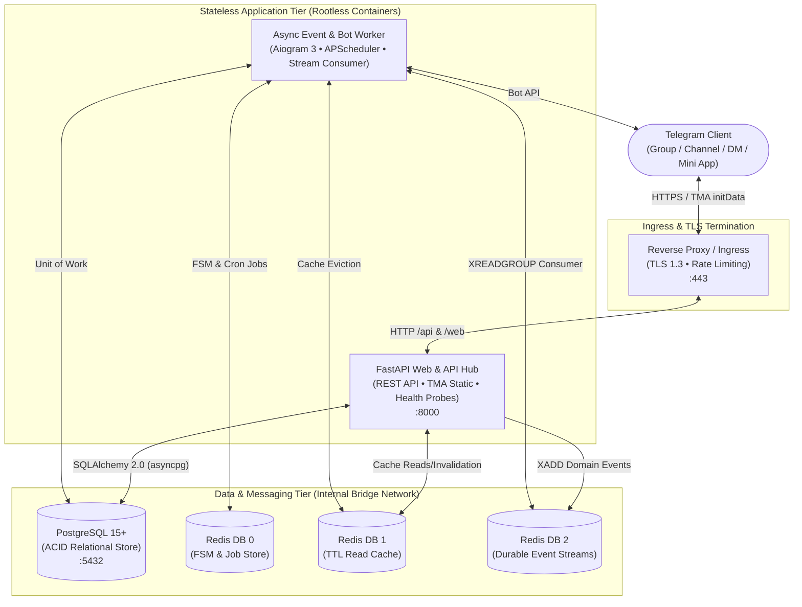
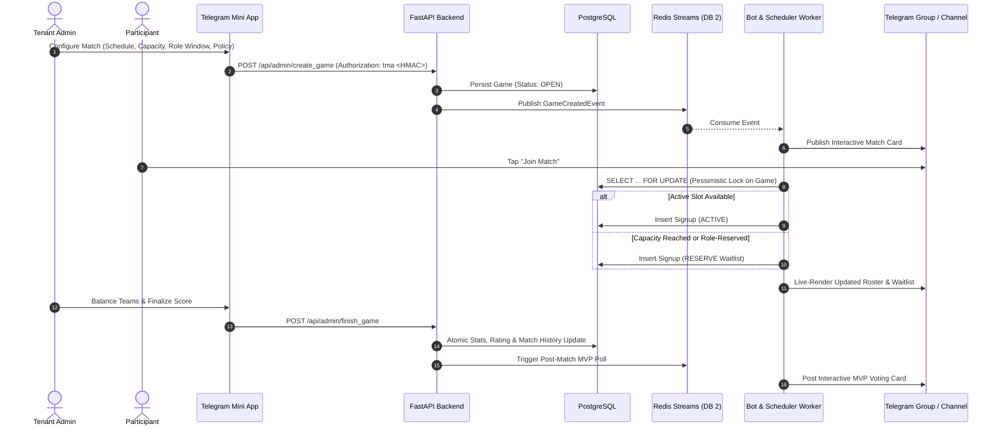
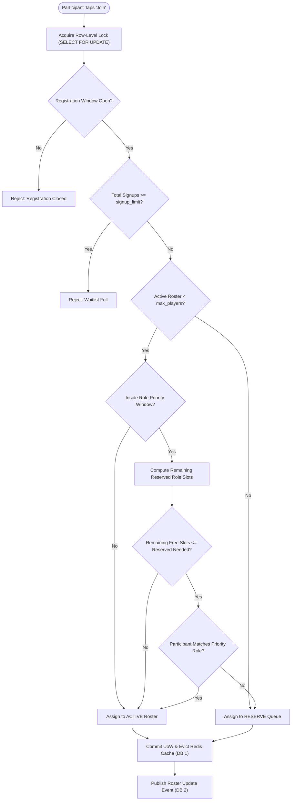

<div align="center">

# Enterprise Sports Logistics & Team Engagement Platform

### Multi-Tenant Event Orchestration, Concurrency-Safe Roster Engine & Telegram Mini Apps for Corporate Clubs, Universities, and Sports Communities

[](https://www.python.org/)
[](https://fastapi.tiangolo.com/)
[](https://docs.aiogram.dev/)
[](https://www.postgresql.org/)
[](https://redis.io/)
[](./Dockerfile)
[](./.github/workflows/deploy.yml)
[](./LICENSE)

**Eliminate spreadsheet chaos and chat-scroll friction.** Deliver native 1-tap match registration, pessimistic-locked waitlists, algorithmic team balancing, post-match MVP voting, and multi-tenant SaaS administration directly inside Telegram Groups, Channels, and Mobile Mini Apps.

[System Overview](#-why-this-platform) • [Architecture](#-architecture--event-flows) • [Security & Resiliency](#-enterprise-security--resiliency) • [Quickstart](#-quickstart) • [Documentation](#-documentation-index)

</div>

---

## Why This Platform?

Organizing recurring team sports inside corporate HR clubs, university leagues, or multi-venue communities breaks down when coordinated manually in group chats: concurrent signups overwrite each other, last-minute dropouts stall waitlists, teams are drafted unevenly, and fee collection becomes a manual chore.

Instead of forcing participants to install yet another standalone mobile app, this platform embeds a **full-featured event and roster engine natively inside Telegram**:

- **Corporate & Enterprise Clubs**: Run HR-sponsored employee wellness leagues across multiple offices or departments with isolated tenant settings, zero-friction onboarding, and engagement analytics.
- **Sports Venues & Amateur Leagues**: Automate recurring pitch bookings, priority goalkeeper/role reservation windows, automated reserve-to-active promotions, payment tracking, and seasonal leaderboards.
- **Engineering Rigor**: Built on asynchronous Python 3.12 (`FastAPI` + `Aiogram 3` + `SQLAlchemy 2.0` + `Redis 7` Streams), featuring row-level pessimistic locking (`SELECT ... FOR UPDATE`), logically isolated Redis namespaces, fail-closed HMAC-SHA256 WebApp authentication, and automated 3-2-1 encrypted backups.

---

## Architecture & Event Flows

### High-Level System Topology



### Match Lifecycle Sequence



### Concurrency-Safe Roster Allocation



---

## Enterprise Security & Resiliency

| Pillar | Implementation |
|:---|:---|
| **Cryptographic WebApp Auth** | Constant-time `hmac.compare_digest` verification of Telegram Mini App `initData` (`HMAC-SHA256`) with replay-window enforcement (`auth_date` TTL) and per-tenant RBAC (`require_system_owner`, `ChatAdmin`). |
| **Fail-Closed Sandbox Guard** | Local browser authentication bypass (`DEV_AUTH_BYPASS`) is fenced by a Pydantic `@model_validator`: enabling it outside `APP_ENV=local_dev` aborts process startup immediately. |
| **Logical Redis Isolation** | Single Redis instance partitioned across isolated logical databases: **DB 0** (FSM & APScheduler jobs), **DB 1** (volatile read cache — safe to flush without dropping jobs), and **DB 2** (Redis Streams event bus with dynamic `hostname-pid` consumer identities). |
| **Rootless Containers & Live Probes** | Multi-stage Python 3.12 slim image running strictly as non-root `appuser`, paired with mode-aware liveness/readiness probes (`/health/live`, `/health/ready`, and worker heartbeat verification via `scripts/container_probe.py`). |
| **3-2-1 Encrypted Disaster Recovery** | Automated `pg_dump -Fc` + Redis RDB snapshots encrypted via `age`/`gpg`, replicated off-site to S3 / Cloudflare R2, guarded by pre-migration snapshot hooks and ephemeral-container restore drills. |
| **Network Segmentation** | PostgreSQL, Redis, and Prometheus bind strictly to internal Docker bridge networks or `127.0.0.1` — zero direct WAN exposure of data stores or telemetry ports. |

---

## Core Capabilities

- **Multi-Tenant Group & Channel Orchestration**: Manage multiple independent clubs or corporate departments from a single deployment; each tenant maintains isolated configuration defaults, schedules, rosters, and leaderboards, with `REGISTRATION_MODE` supporting both instant self-service (`open_saas`) and gated enterprise onboarding (`approval_required`).
- **JSON-Catalog Localization (`EN` / `RU` / `CS`)**: Unified zero-code-change `LocaleCatalog` (`app/locales/*.json`) defaulting universally to English with automatic locale discovery and CI placeholder-parity enforcement across Bot, Services, Scheduler, and Mini Apps.
- **Sport Presets & Tenant Policy Engine**: Built-in `SportPresets` (`football`, `futsal`, `volleyball`, `basketball`, `generic`) and per-tenant JSONB `TenantPolicy` governing free cancellation windows, rating deltas, and dynamic organizer contacts.
- **3-Mode Billing & Czech QR Platba (`SPAYD 1.0`)**: Supports `manual` transfers, `spayd_qr` (ČNB Mod-11 IBAN conversion + offline pure-Python SVG QR generation), and `free_corporate` zero-cost company events.
- **Mobile-First Telegram Mini Apps**:
  - **Match Creator & Editor** (`index.html`, `edit_game.html`): Date/time scheduling, pitch capacity, role windows, and fee configuration.
  - **Interactive Team Balancer & Draft** (`draft.html`): Algorithmic rating + position optimizer across 2 or 3 teams with manual drag/swap overrides.
  - **Match Finalizer & Scoreboard** (`finish.html`): Multi-team score recording, goal/assist tracking, and automatic rating recalculation with lossless rollback support.
  - **Post-Match MVP Voting** (`vote.html`): Adaptive group callback polls and channel deep-link voting (`?start=vote_<id>`) with HTML-sanitized announcements and idempotent award settlement.
  - **SaaS Tenant Dashboard** (`admin.html`): Centralized group configuration, attendance tracking, payment status toggles, and disciplinary card management.

---

## Tech Stack

| Layer | Technology | Role |
|:---|:---|:---|
| **Language & Runtime** | Python `3.12+` | Asyncio-native application runtime |
| **HTTP & WebApp Hub** | FastAPI `0.115+` & Uvicorn | REST API, OpenAPI (non-prod), static Mini App hosting, health probes |
| **Telegram Integration** | Aiogram `3.x` | Webhook & long-polling handlers, inline keyboards, FSM |
| **Persistence & Migrations** | PostgreSQL `15+`, SQLAlchemy `2.0`, Alembic | Async `asyncpg` Unit-of-Work repositories & schema migrations |
| **Cache, Streams & Cron** | Redis `7.x` & APScheduler `3.10+` | Cache (`DB 1`), Streams (`DB 2`), FSM & scheduled jobs (`DB 0`) |
| **Packaging & Quality** | `uv`, Ruff, Pytest, Trivy | Deterministic lockfiles, linting, unit/integration/E2E tests, config scanning |
| **Observability** | Prometheus (`prometheus-fastapi-instrumentator`) | Latency histograms, HTTP status counters, readiness telemetry |

---

## Quickstart

### 1. Isolated Local Developer Sandbox (Recommended for Development)

Spin up a completely isolated local stack (`PostgreSQL :5433`, `Redis :6380`, `FastAPI :8000`, `Worker`, and optional `Cloudflare Tunnel`) without touching any staging or production environment:

```bash
# 1. Copy the developer sandbox template
cp .env.dev.example .env.dev
# Edit .env.dev and insert a dedicated test BOT_TOKEN from @BotFather

# 2. Launch the isolated local stack with live code reload
docker compose -f docker-compose.dev.yml --env-file .env.dev up --build

# 3. Optional: Expose Mini Apps over HTTPS for real mobile Telegram testing
docker compose -f docker-compose.dev.yml --env-file .env.dev --profile tunnel up --build
```

Verify readiness at `http://localhost:8000/health/ready`. See **[docs/DEVELOPMENT.md](./docs/DEVELOPMENT.md)** for full browser bypass (`DEV_AUTH_BYPASS`) and tunnel instructions.

### 2. Production Docker Compose Deployment

```bash
# 1. Initialize persistent volumes, monitoring config, and .env template
chmod +x scripts/setup_server.sh
./scripts/setup_server.sh

# 2. Edit .env with production secrets (APP_ENV=production, DEV_AUTH_BYPASS=False)
nano .env

# 3. Take a pre-migration backup snapshot (for upgrades on existing deployments)
./scripts/backup/pre_migrate_snapshot.sh

# 4. Start the production stack
docker compose up -d --build
```

---

## Health & Operational Probes

| Endpoint / Script | Purpose | Success | Failure |
|:---|:---|:---:|:---:|
| `GET /health/live` | Liveness probe — confirms ASGI event loop responsiveness | `200 OK` | Timeout |
| `GET /health/ready` | Readiness probe — verifies PostgreSQL (`SELECT 1`) and Redis (`PING`) | `200 OK` | `503 Service Unavailable` |
| `scripts/container_probe.py` | Docker `HEALTHCHECK` supporting both `PROBE_MODE=api` and `PROBE_MODE=worker` | `exit 0` | `exit 1` |
| `scripts/health_check.py` | Static AST & clean-architecture layer-boundary verifier (CI gate) | `exit 0` | `exit 1` |

---

## Testing & Quality Gates

```bash
# Install dependencies via uv
uv sync --all-extras

# 1. Static lint & import hygiene
uv run ruff check .

# 2. Clean-architecture boundary check
uv run python scripts/health_check.py

# 3. Full automated test suite (Unit + Integration + E2E)
PYTHONPATH=. uv run pytest
```

---

## Environment Variables Reference

| Variable | Required | Default | Description |
|:---|:---:|:---:|:---|
| `APP_ENV` | No | `production` | Runtime profile: `production`, `staging`, or `local_dev` |
| `DEV_AUTH_BYPASS` | No | `False` | Enables local browser header `Authorization: dev <id>` (**strictly blocked unless `APP_ENV=local_dev`**) |
| `BOT_TOKEN` | **Yes** | — | Telegram Bot API token from [@BotFather](https://t.me/BotFather) |
| `BOT_USERNAME` | No | `sports_manager_bot` | Telegram bot username (without `@`) |
| `WEBAPP_URL` | **Yes** | — | Public HTTPS origin serving `/web/*` Mini Apps |
| `SYSTEM_OWNER_ID` | **Yes** | — | Primary platform owner Telegram User ID |
| `ADMIN_IDS` | No | `[]` | JSON/comma-separated list of global superadmin Telegram IDs |
| `POSTGRES_HOST` | **Yes** | `db` | PostgreSQL hostname |
| `POSTGRES_PORT` | No | `5432` | PostgreSQL port |
| `POSTGRES_DB` | **Yes** | `sports_platform` | PostgreSQL database name |
| `POSTGRES_USER` | **Yes** | `postgres` | PostgreSQL user |
| `POSTGRES_PASSWORD` | **Yes** | — | PostgreSQL password |
| `DB_POOL_SIZE` | No | `8` | SQLAlchemy async pool size per worker process |
| `DB_MAX_OVERFLOW` | No | `8` | Maximum overflow connections per worker process |
| `REDIS_HOST` | No | `redis` | Redis server hostname |
| `REDIS_PORT` | No | `6379` | Redis server port |
| `REDIS_PASSWORD` | **Yes** | — | Redis authentication password |
| `REDIS_FSM_DB` | No | `0` | Logical Redis DB index for Aiogram FSM & APScheduler jobs |
| `REDIS_CACHE_DB` | No | `1` | Logical Redis DB index for application TTL cache |
| `REDIS_STREAM_DB` | No | `2` | Logical Redis DB index for Redis Streams event bus |

---

## Documentation Index

- **[Enterprise Architecture & Domain Design (`v3.0`)](./docs/ARCHITECTURE.md)** — Hexagonal (Ports & Adapters) boundaries, `UnitOfWork` + 8 domain repositories, Redis Streams Outbox, and ADRs 01–09.
- **[Security Architecture, Threat Model & Compliance](./docs/SECURITY.md)** — Telegram WebApp `initData` HMAC-SHA256 verification, BOLA/IDOR tenant guards, `AuditLog` ledger, and Zero-Trust Kubernetes `NetworkPolicy`.
- **[Concurrency, Matchmaking & Rate-Limiting Benchmarks](./docs/BENCHMARKS.md)** — Empirical results for 100-player flash-crowd slot allocation (`p99 = 0.276 ms`), 3-team `2-opt` matchmaking, and `TelegramRenderDebouncer` coalescing.
- **[Configuration, Tenant Policy & Localization Guide](./docs/CONFIGURATION_AND_I18N.md)** — `EN/RU/CS` JSON locale catalog, `SportPresets`, `TenantPolicy` schema, Czech `SPAYD 1.0` QR Platba, and `free_corporate` billing mode.
- **[Developer Sandbox & Workflow Guide](./docs/DEVELOPMENT.md)** — Local Docker Compose sandbox, `DEV_AUTH_BYPASS` browser testing, Cloudflare HTTPS tunnel for mobile WebApps, and CI gates.
- **[Backup & Disaster Recovery Runbook](./docs/BACKUP_AND_DR.md)** — 3-2-1 backup strategy, `age`/`gpg` encryption, S3/R2 off-site sync, pre-migration hooks, and automated restore drills.

---

## License

Released under the [MIT License](./LICENSE).
