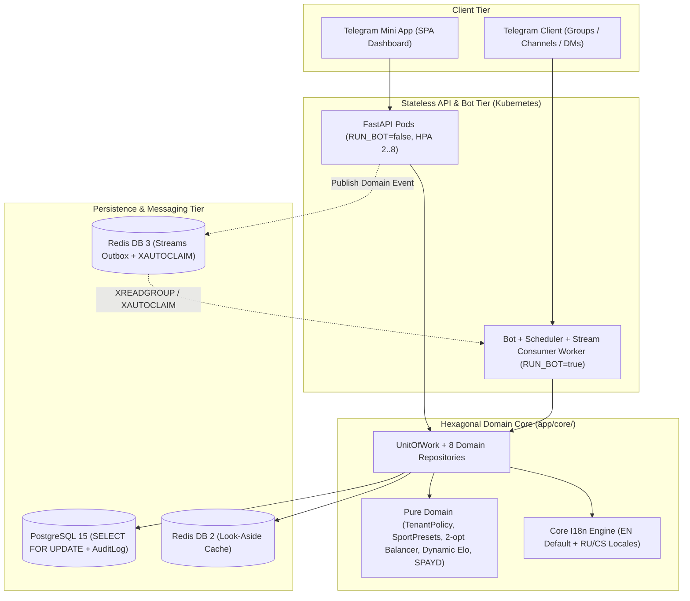

# Enterprise Architecture & Domain Design (`v3.0`)

## 1. Architectural Overview (Hexagonal / Ports & Adapters)

The **Sports Manager & Employee Engagement Platform** is engineered around a strict **Hexagonal Architecture (Ports & Adapters)** with Domain-Driven Design (DDD) tactical patterns:

- **Presentation & Transport Adapters (`app/api/`, `app/bot/`, `app/web/`)**:
  - **FastAPI REST & Telegram Mini App (TMA) Backend (`app/api/routers/`)**: Decomposed into focused, domain-aligned routers (`tenants`, `leaderboards`, `disciplinary`, `rosters`, `votes`, `billing`, `games`, `users`, `inventory`, `admin`).
  - **Aiogram 3.x Bot Adapter (`app/bot/`)**: Handles conversational state machines (`FSM`), inline callback queries, and coalesced live-message rendering (`TelegramRenderDebouncer`).
- **Application & Domain Core (`app/core/`)**:
  - **Zero Outer-Layer Coupling**: Enforced in CI via `scripts/health_check.py` and `tests/unit/test_phase2_architecture.py` — `app/core/` never imports `app.bot` or `app.api`.
  - **Pure Domain Models & Strategies (`app/core/domain/`)**:
    - `TenantPolicy` (`tenant_policy.py`): Typed per-tenant JSON policy governing rating systems (`simple_points` vs. `dynamic_elo`), GK priority windows, cancellation deadlines, auto-balance rules, and billing modes (`manual`, `spayd_qr`, `free_corporate`).
    - `SportPreset` (`sport_presets.py`): Pluggable sport presets (`football`, `futsal`, `volleyball`, `basketball`) defining positions, positional buckets, and team sizing.
    - `RoleBasedBalancingStrategy` + `2-opt` Local Search (`balancer.py`): Multi-team (`2..N`) serpentine draft followed by deterministic within-bucket `2-opt` swap optimization minimizing inter-team rating variance while keeping primary goalkeepers locked.
    - `IRatingStrategy` (`ratings.py`): Pluggable rating engines (`SimplePointsRatingStrategy` and `DynamicEloRatingStrategy` with provisional `K`-factor scaling).
    - `generate_spayd_payload` (`spayd.py`): Pure Czech Banking Standard (`SPD*1.0`) QR payload generator with MOD-97-10 (ISO 7064) IBAN synthesis.
- **Persistence & Unit of Work (`app/core/uow.py`, `app/core/repositories/`)**:
  - Atomic `UnitOfWork` coordinating 8 repositories (`GameRepository`, `UserRepository`, `TenantRepository`, `SignupRepository`, `VoteRepository`, `DisciplinaryRepository`, `StatsRepository`, `AnnouncementRepository`) over a single `AsyncSession`, with post-commit Redis cache eviction (`defer_cache_eviction`) and post-commit domain event hooks.
- **Distributed Infrastructure (`app/infrastructure/`)**:
  - **Redis 7 Logical DB Isolation**: Dedicated logical databases for Aiogram FSM (`DB 0`), APScheduler jobs (`DB 1`), Look-Aside Read Cache (`DB 2`), and Redis Streams Outbox (`DB 3`).
  - **Redis Streams Consumer Group (`messaging.py`)**: Dynamic pod-unique consumer identity (`consumer-{hostname}-{pid}`), `XAUTOCLAIM` stale message recovery, and bounded idempotency deduplication.

---

## 2. Architecture Decision Records (Summary)

| ADR | Decision | Architectural Rationale |
| :--- | :--- | :--- |
| **ADR-01** | Strict Hexagonal Layer Boundaries | Prevents circular dependencies and allows stateless API replicas to scale independently of the Telegram Bot worker. |
| **ADR-02** | `TenantPolicy` & `SportPreset` Parameterization | Replaces hardcoded football/currency/rating constants with validated per-tenant JSON policies (`chats.policy`). |
| **ADR-03** | Universal English (`en`) Default + JSON Dictionary i18n | Ensures international B2B readiness with three-tier locale resolution (`user.language -> chat.language -> 'en'`). |
| **ADR-04** | Lossless Schema Constraints & `O(1)` Match Sequence | Persists `games.sequence_number` at creation time and enforces `UniqueConstraint(game_id, user_id)` on `game_stats` and `rating_history`. |
| **ADR-05** | Post-Commit Cache Eviction & Debounced Renderer | Evicts Redis keys strictly after `session.commit()` and coalesces Telegram message edits (`<= 18` edits/min/chat). |
| **ADR-06** | `2-opt` Local-Search Balancer & Dynamic Elo | Minimizes inter-team rating variance across `2..N` teams while preserving positional bucket counts; supports pairwise multi-team Elo. |
| **ADR-07** | Pluggable Billing (`manual`, `spayd_qr`, `free_corporate`) | Automates Czech domestic QR banking (`SPD*1.0`) with deterministic `VS` (`{game_id}{abs(user_id) % 100000:05d}`). |
| **ADR-08** | Cloud-Native Split Deployment (`deploy/k8s/`) | Separates horizontally autoscaled API pods (`HPA`) from singleton/consumer workers under Zero-Trust `NetworkPolicy`. |
| **ADR-09** | BOLA/IDOR Tenant Guards & `AuditLog` Ledger | Enforces tenant membership verification and records immutable administrative audit trails in `audit_logs`. |
