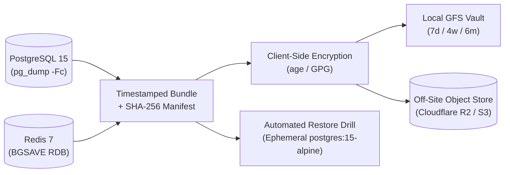

# 3-2-1 Backup & Disaster Recovery Runbook

This runbook documents the backup, encryption, off-site replication, pre-migration snapshotting, and automated restore verification procedures for the platform.

---

## 1. Architecture Overview (3-2-1 Strategy)

Every production deployment should maintain **3 copies** of stateful data across **2 storage media**, with **1 encrypted copy off-site**:

1. **Primary Live State**: Docker named volumes (`football-prod_postgres_data` and `football-prod_redis_data`).
2. **Local Encrypted Archive**: Timestamped `pg_dump -Fc` custom-format PostgreSQL dumps + Redis RDB snapshots stored on host storage (`BACKUP_ROOT`, default `/var/backups/football-manager`), pruned automatically via Grandfather-Father-Son (**GFS**) retention (`7` daily, `4` weekly, `6` monthly).
3. **Off-Site Object Storage**: Client-side encrypted archives (`.age` or `.gpg`) + `.sha256` manifests uploaded to S3-compatible object storage (Cloudflare R2, AWS S3, Backblaze B2) or any `rclone` remote.



---

## 2. Backup Scripts Reference

All scripts reside in [`scripts/backup/`](../scripts/backup/):

| Script | Purpose | When to Run |
|:---|:---|:---|
| [`backup_stack.sh`](../scripts/backup/backup_stack.sh) | Full PostgreSQL (`pg_dump -Fc`) + Redis RDB snapshot, `age`/`gpg` encryption, SHA-256 manifest, S3/R2/`rclone` upload, and GFS retention pruning. | Scheduled via `cron` / `systemd` timer (e.g., every 6 hours or nightly at `03:00 UTC`). |
| [`pre_migrate_snapshot.sh`](../scripts/backup/pre_migrate_snapshot.sh) | Takes a mandatory synchronous `pg_dump -Fc` snapshot right before `alembic upgrade head` and prints the exact one-line `pg_restore` rollback command. | Before **every** production database migration or major release rollout. |
| [`verify_restore_drill.sh`](../scripts/backup/verify_restore_drill.sh) | Boots an isolated, disposable `postgres:15-alpine` container, restores the latest dump via `pg_restore --exit-on-error`, verifies core table row counts (`users`, `chats`, `games`, `signups`, `alembic_version`), and destroys the temporary container. | Weekly automated cron job and immediately before major schema upgrades. |

---

## 3. Configuring Automated Encrypted Backups

### Step 1: Generate an `age` Keypair (Recommended)

Install [`age`](https://github.com/FiloSottile/age) on your server and generate a keypair. Store the **private key** (`key.txt`) in your password manager / off-server vault — the server only needs the **public recipient key** (`age1...`) to encrypt backups!

```bash
age-keygen -o ~/fm-backup-private-key.txt
# Copy ~/fm-backup-private-key.txt to your off-server password vault, then note the public key:
# Public key: age1ql3z7hjy54pw3hyww5ayyfg7zqgvc7w3j2elw8zmrj2kg5sfn9aqmcac8p
```

### Step 2: Configure Backup Environment Variables

Create `/etc/football-manager/backup.env` (`chmod 600`):

```bash
BACKUP_ROOT=/var/backups/football-manager
COMPOSE_FILE=/opt/football-manager/docker-compose.yml

# Client-side encryption (Public key only on server!)
AGE_RECIPIENT="age1..."

# Optional: Off-site S3 / Cloudflare R2 replication
S3_BUCKET="s3://my-encrypted-sports-backups/prod"
S3_ENDPOINT_URL="https://<account-id>.r2.cloudflarestorage.com"
AWS_ACCESS_KEY_ID="<r2-access-key>"
AWS_SECRET_ACCESS_KEY="<r2-secret-key>"

# Retention policy
RETENTION_DAILY=7
RETENTION_WEEKLY=4
RETENTION_MONTHLY=6
```

### Step 3: Schedule Cron Jobs (`crontab -e`)

```cron
# Nightly encrypted backup + off-site sync at 03:00 UTC
0 3 * * * set -a && . /etc/football-manager/backup.env && set +a && /opt/football-manager/scripts/backup/backup_stack.sh >> /var/log/fm-backup.log 2>&1

# Weekly automated restore drill every Sunday at 04:00 UTC (using an unencrypted local snapshot or decrypted test copy)
0 4 * * 0 BACKUP_ROOT=/var/backups/football-manager /opt/football-manager/scripts/backup/verify_restore_drill.sh >> /var/log/fm-restore-drill.log 2>&1
```

---

## 4. Safe Schema Migration Procedure

Never execute `alembic upgrade head` against production without running the pre-migration snapshot hook first:

```bash
# 1. Create a verified pre-migration snapshot
./scripts/backup/pre_migrate_snapshot.sh

# 2. Verify the snapshot restores cleanly in an ephemeral container
./scripts/backup/verify_restore_drill.sh /var/backups/football-manager/pre_migrate/pre_migrate_<timestamp>.dump

# 3. Apply Alembic migrations
docker compose exec app alembic upgrade head
```

---

## 5. Emergency Rollback & Full Restore Procedure

### Decrypting an `.age` Archive (If Restoring from Encrypted / Off-Site Copy)

```bash
# Verify SHA-256 integrity first
sha256sum -c fm_backup_20261103T030000Z.tar.gz.age.sha256

# Decrypt using your off-server private key
age -d -i /path/to/fm-backup-private-key.txt \
  -o fm_backup_20261103T030000Z.tar.gz \
  fm_backup_20261103T030000Z.tar.gz.age

tar -xzf fm_backup_20261103T030000Z.tar.gz
```

### Restoring PostgreSQL

```bash
# 1. Stop application writers so no active sessions lock tables
docker compose stop app worker

# 2. Restore cleanly with --clean --if-exists --no-owner
cat postgres.dump | docker compose exec -T db sh -c \
  'pg_restore -U "$POSTGRES_USER" -d "$POSTGRES_DB" --clean --if-exists --no-owner --exit-on-error'

# 3. Restart application tier and check readiness
docker compose start worker app
curl -fsS http://localhost:8000/health/ready
```
